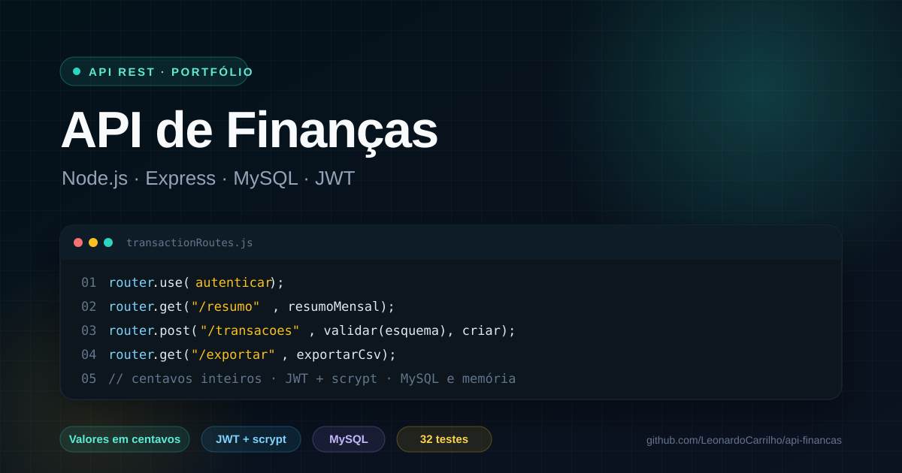

# api-financas

[](https://github.com/LeonardoCarrilho/api-financas/actions/workflows/ci.yml)
[](LICENSE)

API REST de finanças pessoais com **Node.js, Express, MySQL e JWT**: contas,
categorias, transações, resumo mensal por categoria e exportação CSV. Valores
monetários trafegam e são armazenados em **centavos inteiros**, sem ponto
flutuante.

Repositório: https://github.com/LeonardoCarrilho/api-financas



## Stack

Node.js 20+ · Express 4 · MySQL 8 (`mysql2/promise`) · JWT (`jsonwebtoken`) ·
senhas com `scrypt` nativo · validação com Zod · testes com `node:test` +
`supertest`.

## Funcionalidades

- Cadastro e login com **JWT** e senha protegida por `scrypt` (sal por usuário).
- CRUD de **contas** com saldo calculado a partir do saldo inicial + transações.
- CRUD de **categorias** de receita/despesa, com cor e unicidade por nome/tipo.
- CRUD de **transações** com filtros por período, tipo, conta, categoria e busca.
- Paginação com `X-Total-Count`, `X-Page`, `X-Page-Size` e `Link`.
- **Resumo mensal**: receitas, despesas, saldo do período, saldo total das contas,
  totais por categoria e por mês.
- **Exportação CSV** com BOM UTF-8, separador `;` e escape de aspas — pronta para
  abrir no Excel em português.
- Isolamento por usuário: toda consulta é filtrada pelo `user_id` do token.
- Erros padronizados (`400`, `401`, `404`, `409`, `422`, `500`) com mensagens em
  português e detalhes por campo quando a validação falha.

## Como rodar

### Com Docker (mais rápido)

```bash
docker compose up --build
```

O serviço da API executa a migração automaticamente antes de subir. O MySQL fica
exposto na porta **3307** (para não conflitar com um MySQL local) e a API em
`http://localhost:3000`.

Para carregar os dados de demonstração:

```bash
docker compose exec api node src/db/seed.js
```

### Manualmente

```bash
git clone https://github.com/LeonardoCarrilho/api-financas.git
cd api-financas
npm install
cp .env.example .env      # ajuste as credenciais do MySQL
npm run migrate           # cria o banco e as tabelas
npm run seed              # opcional: usuário e dados de demonstração
npm run dev               # http://localhost:3000
```

O usuário criado pelo seed é `demo@financas.dev` com a senha `demo12345`
(configurável em `SEED_EMAIL` e `SEED_PASSWORD`).

## Endpoints

Todos os endpoints abaixo de `/api` exigem `Authorization: Bearer <token>`,
exceto `/api/health` e as rotas de autenticação.

| Método | Rota | Descrição |
| --- | --- | --- |
| `GET` | `/api/health` | Status do serviço (público) |
| `POST` | `/api/auth/register` | Cria usuário e devolve token |
| `POST` | `/api/auth/login` | Autentica e devolve token |
| `GET` | `/api/me` | Dados do usuário autenticado |
| `GET` | `/api/accounts` | Lista contas com saldo |
| `POST` | `/api/accounts` | Cria conta |
| `PUT` | `/api/accounts/:id` | Atualiza conta |
| `DELETE` | `/api/accounts/:id` | Remove conta (e suas transações) |
| `GET` | `/api/categories?type=` | Lista categorias |
| `POST` | `/api/categories` | Cria categoria |
| `PUT` | `/api/categories/:id` | Atualiza categoria |
| `DELETE` | `/api/categories/:id` | Remove categoria (transações ficam sem categoria) |
| `GET` | `/api/transactions` | Lista com filtros e paginação |
| `GET` | `/api/transactions/:id` | Detalha uma transação |
| `POST` | `/api/transactions` | Cria transação |
| `PUT` | `/api/transactions/:id` | Atualiza transação |
| `DELETE` | `/api/transactions/:id` | Remove transação |
| `GET` | `/api/reports/summary` | Resumo do período (padrão: mês atual) |
| `GET` | `/api/reports/transactions.csv` | Exporta as transações do período |

### Exemplos

```http
POST /api/auth/login
Content-Type: application/json

{ "email": "demo@financas.dev", "password": "demo12345" }
```

```http
POST /api/transactions
Authorization: Bearer <token>
Content-Type: application/json

{
  "accountId": 1,
  "categoryId": 1,
  "type": "expense",
  "amountCents": 62400,
  "description": "Compras do mês",
  "occurredOn": "2026-10-09"
}
```

Filtros da listagem: `from`, `to`, `type`, `accountId`, `categoryId`, `search`,
`page` e `limit` (máximo 100). O arquivo [`requests.http`](requests.http) tem
todos os exemplos prontos para VS Code REST Client ou JetBrains HTTP Client.

## Decisões de projeto

### Valores em centavos

Toda a API usa `amountCents`/`initialBalanceCents` como inteiros. Isso evita
`0.1 + 0.2` e mantém o banco (`BIGINT`) e o JSON coerentes. A conversão para
`R$` acontece apenas na borda (CSV), com `centavosParaCsv`.

### Senhas

Hash com `scrypt` (N=16384, r=8, p=1) e sal aleatório de 16 bytes, no formato
`scrypt$N$r$p$sal$hash`. A comparação usa `timingSafeEqual`. Quando o e-mail não
existe, o login ainda executa um hash fictício para não revelar, pelo tempo de
resposta, quais e-mails estão cadastrados.

### Tokens

JWT com `sub` = id do usuário, emissor `api-financas` e expiração configurável
(`JWT_EXPIRES_IN`, padrão `1d`). Em produção, `JWT_SECRET` é obrigatório e a
aplicação se recusa a subir com o valor de desenvolvimento.

### Dois conjuntos de repositórios

`src/repositories/mysql` implementa as consultas SQL reais e
`src/repositories/memory` implementa a mesma interface em memória. Os testes de
API rodam contra a versão em memória — rápidos e sem depender de Docker —, e o
servidor usa a versão MySQL. As interfaces são idênticas, então os serviços não
sabem qual está por trás.

### Datas

`occurredOn` é uma data (`DATE`) no formato `AAAA-MM-DD`, validada de verdade
(rejeita `2026-02-31`). O resumo sem filtros usa o mês corrente no fuso local,
não em UTC.

## Testes

```bash
npm test              # 32 testes
npm run test:coverage # cobertura pelo Node Test Runner
```

Os testes cobrem autenticação (registro, login, token inválido), CRUD de contas,
categorias e transações, isolamento entre usuários, validação de entrada,
paginação, resumo por período, CSV, hash de senha, datas e utilitários. Os
repositórios MySQL não são exercitados nos testes automatizados; a validação
deles é feita subindo o `docker compose` e usando o `requests.http`.

## Estrutura

```
.
├── sql/schema.sql              # tabelas InnoDB, FKs e índices
├── src/
│   ├── app.js                  # Express + middlewares + rotas
│   ├── server.js               # bootstrap e encerramento gracioso
│   ├── config/env.js           # variáveis de ambiente validadas
│   ├── db/
│   │   ├── pool.js             # pool MySQL e helper de transação
│   │   ├── migrate.js          # cria banco e aplica o schema
│   │   └── seed.js             # dados de demonstração idempotentes
│   ├── http/schemas.js         # validação Zod
│   ├── middlewares/            # auth, validação e tratamento de erros
│   ├── repositories/
│   │   ├── mysql/              # implementação SQL
│   │   └── memory/             # implementação para testes
│   ├── routes/                 # auth, accounts, categories, transactions, reports
│   ├── services/               # regras de negócio
│   └── utils/                  # jwt, password, datas, csv, erros
├── tests/
├── Dockerfile
├── docker-compose.yml
└── requests.http
```

## Limitações e próximos passos

- Sem refresh token: o token expira e o usuário faz login novamente.
- Sem rate limit nas rotas de autenticação (o `api-tarefas` tem uma
  implementação que pode ser reaproveitada).
- Sem testes de integração com MySQL real no CI; o `docker compose` cobre o
  fluxo manual.
- Evolução natural: orçamento por categoria, transações recorrentes e um front
  consumindo esta API.

## Licença

[MIT](LICENSE) © Leonardo Fernandes Carrilho

## Contribuição e segurança

Leia [AGENTS.md](AGENTS.md) antes de alterar o projeto. Toda tarefa exige issue e PR associado, com validação antes da publicação.

Configuração de produção, observabilidade e limites da hospedagem: [docs/SECURITY.md](docs/SECURITY.md).
